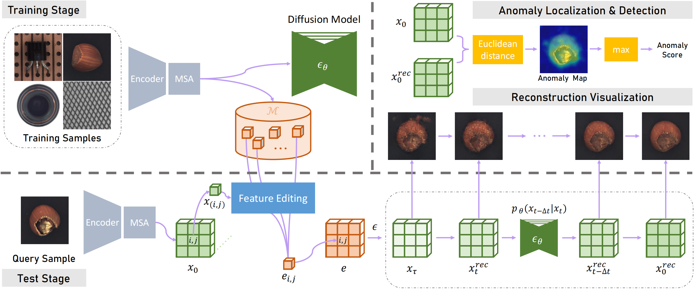
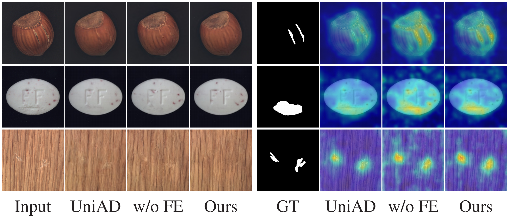

# LafitE

PyTorch Implementation of ***LafitE: Latent Diffusion Model with Feature Editing for Unsupervised Multi-class Anomaly Detection***.




## 1. Quick Start

### 1.1 MVTec-AD

- **Create the MVTec-AD dataset directory**. Unzip the dataset file and move to your `FilePath`. You should modify your [MVTec-AD config](./experiments/MVTec-LafitE/config.yaml) and set `dataset.image_reader.kwargs.image_dir` to your `FilePath`.

- **Set the root path** by running `cd xxx/LafitE`.
- **Train or test** by running:

  ```
  bash scripts/MVTec/train-MVTec-LafitE.sh GPU
  ```
  **Note**: `GPU` means your device number.
- **Results and checkpoints**. Training on 1 single GPU (NVIDIA GeForce RTX 3090 24GB) results in following performance.


| Method | Detection AUROC | Localization AUROC | AUPRO | Checkpoints |
| - | - | - | - | - |
| ***LafitE w/o F.E.*** | 97.9 | 97.2 | 93.1 | Null |
| ***lafitE w F.E.*** | 98.4 | 97.5 | 93.5 | Null |

### 1.2 MPDD

- Similar to MVTec, just set the `FilePath` to your MPDD dataset path and change categories in `vis_decoder` and `recon` scripts to MPDD categories:
  ```
  bracket_black bracket_brown bracket_white connector metal_plate tubes
  ```

- **Results and checkpoints**. Training on 1 single GPU (NVIDIA GeForce RTX 3090 24GB) results in following performance.


| Method | Detection AUROC | Localization AUROC | AUPRO | Checkpoints |
| - | -- | - | - | - |
| ***LafitE w/o F.E.*** | 93.5 | 98.3 | 92.3 | Null |
| ***LafitE w F.E.*** | 96.2 | 98.9 | 95.2 | Null |

## 2. Feature Editing on MVTec-AD Dataset

### 2.1 Generate a Memory Bank for Feature Editing
This training step is irrelevant to the model training step, you can do this individually.

- **Set the root path** by running `cd xxx/LafitE`.
- **Train** by running:

  ```
  bash scripts/MVTec/gen_membank-MVTec-LafitE.sh GPU
  ```
  **Note**: `GPU` means your device number. Coreset sampling ratio can be set in this script.

### 2.2 Test with Feature Editing
Please generate a memory bank before the test phase. If you don't want to use Feature Editing, you can run `main/train_val_diff.py` with it's `evaluate` arg.

- **Set the root path** by running `cd xxx/LafitE`.
- **Train** by running:

  ```
  bash scripts/MVTec/test-MVTec-LafitE.sh GPU
  ```
  **Note**: `GPU` means your device number. Coreset sampling ratio and number of neighbors can be set in this script.

## 3. Visualize Reconstructed Features on MVTec-AD Dataset

Visualizing reconstructed features could directly show that our ***LafitE*** can mitigate the notorious ***“identity shortcut”*** issue.

### 3.1 Train Decoders for Visualization

- **Set the root path** by running `cd xxx/LafitE`.
- **Train** by running:

  ```
  bash scripts/MVTec/train-MVTec-vis_decoder.sh GPU
  ```
  **Note**: `GPU` means your device number.

### 3.2 Visualize Reconstructed Features

- **Set the root path** by running `cd xxx/LafitE`.
- **Visualize** by running (only support 1 GPU):

  ```
  bash scripts/MVTec/recon-MVTec.sh GPU
  ```
  **Note**: `GPU` means your device number.

## 4. Medical LafitE × MLLM Diagnostic Experiments

The repository now includes three falsification-first experiments for medical
LafitE/MLLM research:

1. layer-wise lesion-detail decodability probes;
2. paired lesion-removal/background-nuisance interventions;
3. LLM necessity under unseen organ-finding compositions and four evidence ×
   knowledge conditions.

Run the non-medical installation smoke suite with:

```bash
bash scripts/medical/run-smoke-suite.sh
```

See [the medical diagnostic experiment guide](docs/medical-diagnostic-experiments.md)
for the patient-level manifest schema, model factory interfaces, real-data
configuration, leakage controls, metrics, and interpretation rules.

For the ready-to-run single-A100 Qwen3-VL-8B + LafitE configuration, see
[the Qwen3-VL diagnostics runbook](docs/qwen3vl-medical-diagnostics-runbook.md).
